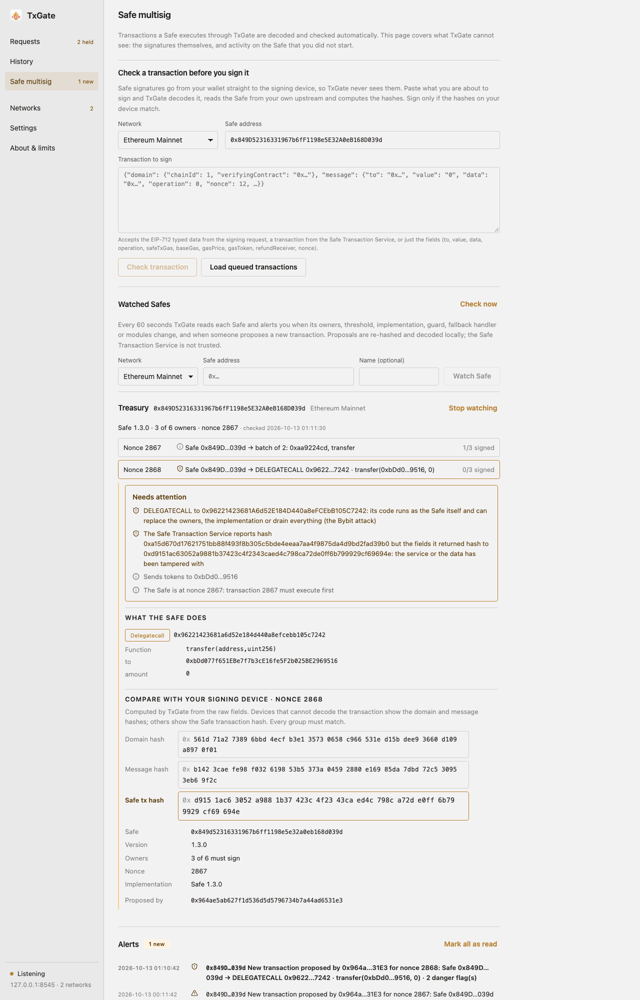
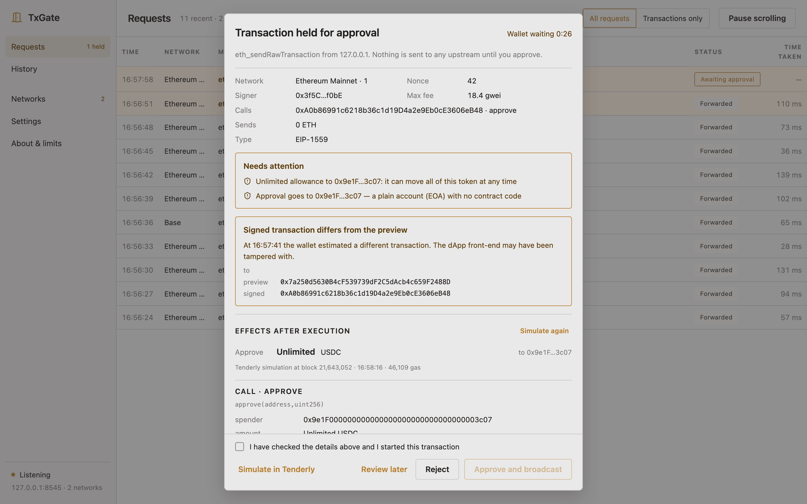
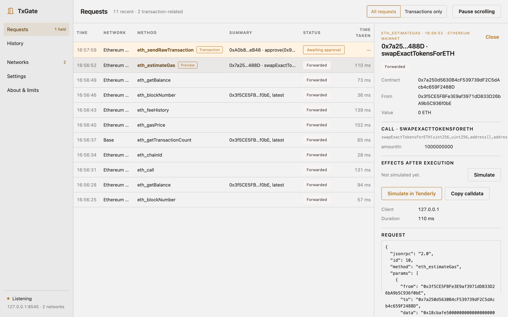
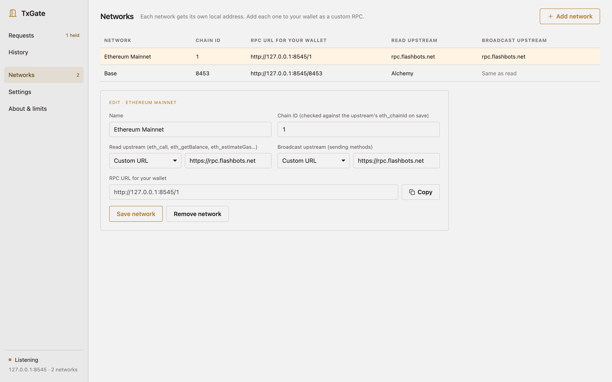
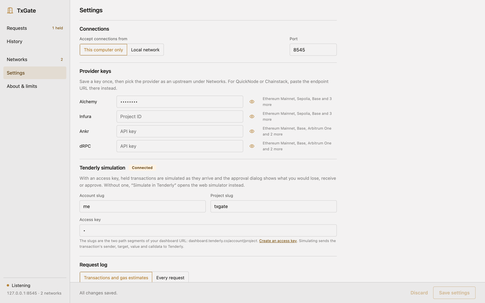

# TxGate

[English](../README.md) | [简体中文](README.zh-CN.md) | [繁體中文](README.zh-TW.md) | [Italiano](README.it.md) | **Français** | [Português](README.pt.md)

Le gardien du RPC de votre portefeuille : inspectez chaque requête et approuvez chaque transaction avant sa diffusion.

TxGate est une application de bureau (macOS, Windows, Linux) qui exécute un point d'accès JSON-RPC Ethereum local. Pointez votre portefeuille vers TxGate plutôt que vers un RPC public :

- Les **lectures** (`eth_call`, `eth_getBalance`, …) sont transmises à l'upstream de votre choix et affichées en direct.
- **`eth_estimateGas`** est mis en évidence : cela signifie généralement que le portefeuille va vous demander de signer. TxGate décode l'appel et signale les schémas risqués.
- Les **méthodes d'envoi** (`eth_sendRawTransaction`, `eth_sendRawTransactionSync`, `eth_sendRawTransactionConditional`, `eth_sendTransaction`, `eth_sendBundle`, `eth_sendPrivateTransaction`) sont **retenues**. Rien n'atteint le réseau tant que vous n'avez pas approuvé la transaction dans TxGate.

Ce que montre la fenêtre d'approbation :

- La transaction décodée : signataire, cible, fonction, arguments et valeur.
- Des signalements de risque, par exemple :
  - autorisations illimitées
  - `setApprovalForAll`
  - appels Permit/Permit2
  - autorisations vers des comptes sans code de contrat
  - délégations EIP-7702
  - ID de chaîne incohérents
  - trous de nonce
- Une comparaison avec l'estimation de gas faite plus tôt par le portefeuille. Si les deux diffèrent, le front-end de la dApp a peut-être remplacé la transaction.
- Les variations simulées de soldes et d'autorisations, lorsqu'une access key Tenderly est configurée.

L'interface, les messages de risque, les alertes Safe et les notifications de bureau sont disponibles en English, 简体中文, 繁體中文, Italiano, Français et Português. TxGate suit la langue du système jusqu'à ce que vous en choisissiez une dans **Paramètres → Langue**.

### Safe multisig

Un Safe déplace des fonds avec une seule `execTransaction` on-chain, une fois que les propriétaires ont signé hors chaîne. TxGate couvre les deux étapes (détails dans [SAFE.md](SAFE.md), en anglais) :

- **`execTransaction` retenue** : TxGate déplie la transaction Safe, y compris les lots MultiSend, et applique les vérifications habituelles à chaque appel interne. Un `DELEGATECALL` vers tout autre contrat que les MultiSend / SignMessageLib officiels de Safe est signalé comme dangereux : c'est ainsi que le Safe de Bybit a été pris. TxGate lit aussi le Safe depuis votre propre upstream, calcule le hash à son nonce actuel et vérifie chaque signature par rapport aux propriétaires et au seuil. Il signale une implémentation non officielle, les modules activés et les auto-appels qui modifient les propriétaires, le seuil, le guard, les modules ou le fallback handler.
- **`approveHash` retenu** : TxGate cherche le hash dans le Safe Transaction Service, le recalcule à partir des champs renvoyés et montre ce que vous approuvez.
- **Avant de signer** (page Safe multisig) : collez les typed data EIP-712, ou choisissez une transaction en file. TxGate la décode et affiche le hash du domain, le hash du message et le hash de la transaction Safe à comparer avec l'écran de votre portefeuille matériel.
- **Safes surveillés** : TxGate interroge régulièrement chaque Safe et vous alerte, par une notification de bureau, quand les propriétaires, le seuil, l'implémentation, le guard, le fallback handler ou les modules changent, et quand quelqu'un propose une nouvelle transaction. Les propositions du Transaction Service sont recalculées localement : un service falsifié est détecté au lieu d'être cru.



## Captures d'écran

La fenêtre d'approbation. Cette transaction accorde une autorisation USDC illimitée à un compte sans code de contrat, et la transaction signée vise un autre contrat que celui que le portefeuille avait prévisualisé avec `eth_estimateGas` :



Le moniteur de requêtes en direct, avec une estimation de gas (Aperçu) ouverte dans le panneau de détails :



Réseaux : chaque chaîne a sa propre URL RPC locale et des upstreams séparés pour la lecture et la diffusion :



Paramètres : adresse d'écoute, clés des fournisseurs, simulation Tenderly et journal des requêtes :



## Limites

- Les demandes de signature (`personal_sign`, `eth_signTypedData*`, y compris Permit / Permit2 et les signatures des propriétaires Safe) ne passent jamais par le RPC, donc TxGate ne les voit pas. Pour les transactions Safe, vérifiez-les dans la page Safe multisig avant de signer.
- Les vérifications Safe lisent l'état des contrats avec `eth_call`. Flashbots Protect (l'upstream mainnet par défaut) ne prend pas en charge `eth_call` : donnez à mainnet un upstream de lecture séparé pour en bénéficier.
- TxGate peut seulement approuver ou refuser une transaction. Une transaction signée ne peut pas être modifiée.
- L'écoute sur `0.0.0.0` n'a pour l'instant pas de jeton d'accès. N'importe qui sur votre réseau local peut utiliser le port et les clés de fournisseur qui se trouvent derrière.
- Les requêtes portant l'`Origin` d'un site web ordinaire sont refusées, afin qu'une page que vous visitez ne puisse pas utiliser le point d'accès à votre insu. Les extensions de portefeuille, les portefeuilles natifs et les pages sur `localhost` sont autorisés (avec CORS).

## Utilisation

1. Lancez TxGate. Il écoute sur `http://127.0.0.1:8545`.
2. Dans **Réseaux**, ajoutez chaque chaîne que vous utilisez. Mainnet est préconfiguré avec Flashbots Protect (`https://rpc.flashbots.net`). Vous pouvez donner à un réseau des upstreams séparés pour la *lecture* et la *diffusion*, et enregistrer des clés Alchemy / Infura / Ankr / dRPC dans **Paramètres** pour ne pas avoir à saisir d'URL. Les identifiants Tenderly, l'adresse d'écoute et la journalisation s'y trouvent aussi.
3. Dans votre portefeuille, définissez l'URL RPC du réseau sur `http://127.0.0.1:8545/<chainId>`, par exemple `/1` pour mainnet ou `/8453` pour Base (l'hexadécimal comme `/0x2105` fonctionne aussi).

Quand le portefeuille envoie une transaction, TxGate vous prévient et ouvre la fenêtre d'approbation. Si vous refusez, le portefeuille reçoit l'erreur JSON-RPC `4001`. Si le portefeuille cesse d'attendre, la transaction signée reste dans la file et vous pouvez toujours la diffuser ou l'abandonner.

Les paramètres, y compris les clés API en clair, sont stockés dans `config.toml` dans le dossier de configuration de l'application. Le journal des requêtes est `txgate.sqlite` dans le dossier de données de l'application et il est conservé indéfiniment.

## Développement

Prérequis : Rust (stable), Node.js 20+ et les [prérequis de Tauri](https://tauri.app/start/prerequisites/) pour votre système.

```sh
npm run setup        # installe la CLI Tauri et les dépendances de l'UI
npm run dev          # lance l'application avec rechargement à chaud
npm run build        # crée les installeurs dans target/release/bundle
cargo test --workspace
```

Envoyer du trafic de type portefeuille à une instance en cours d'exécution :

```sh
npm run wallet:sim -- reads      # aussi : estimate | send | batch | all
```

`npm --prefix ui run dev` ouvre l'UI dans un navigateur avec des données d'exemple, pratique pour travailler la mise en page.

### Organisation

| Chemin | Contenu |
|---|---|
| `crates/txgate-core` | Le moteur du proxy : configuration, routage, file d'approbation, décodage, vérifications de risque, Tenderly, journal SQLite, serveur HTTP. Aucune dépendance à Tauri ; entièrement testé. |
| `src-tauri` | Coquille de bureau : commandes, pont d'événements, icône de la zone de notification, notifications. |
| `ui` | Interface React + TypeScript basée sur le design system Classical de `UX/`. |
| `ui/src/i18n/locales` | Traductions, un fichier JSON par langue. Les messages anglais du moteur sont aussi produits à partir de `en.json` ; un test vérifie que chaque langue contient chaque texte avec les mêmes `{paramètres}`. |
| `docs/SAFE.md` | Fonctionnement de Safe multisig et vérifications faites par TxGate (en anglais). |

## Licence

GPL-3.0
